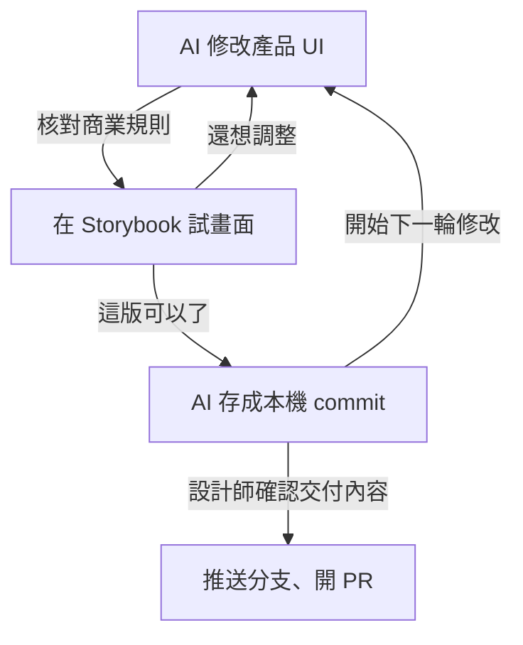

<h1 align="center">Visual Engineering Playbook</h1>
<p align="center"><strong>設計師的前端實作手冊</strong><br>
用 AI 修改產品介面，在 Storybook 裡親自試，再把滿意的版本交給工程師。</p>
<p align="center">
  <a href="#手冊目錄">手冊目錄</a> ·
  <a href="#快速開始">快速開始</a> ·
  <a href="#從修改到交付">從修改到交付</a>
</p>

這本手冊寫給想直接調整產品 UI/UX 的設計師，不需要讀寫程式碼。你可以改一個頁面的排版、調整整個產品共用的按鈕，也可以實際走一遍跨頁流程，看看使用者在哪一步會卡住。

手冊搭配一份給 AI 用的 `design-with-storybook` Skill。實際修改發生在團隊的**產品 repo**。只要產品功能已經能用，也有可運作的 Storybook，即使目標頁面還沒有自己的 Story，AI 也可以用現有元件和模擬資料把畫面組起來，不用啟動後端。

## 手冊目錄

| 章節 | 什麼時候讀 |
| --- | --- |
| [第一次設定](guidebook/getting-started.md) | 剛拿到團隊的 GitHub 網址，想知道怎麼安裝 Git、下載產品、選對 Node.js 版本，並讓 AI 載入 Skill。 |
| [實作範例 · 改善邀請表單](guidebook/first-change.md) | 想跟著做一次完整修改。從「按了寄送，不知道有沒有送出」開始，試等待、失敗和重試，最後開出第一個 PR。 |
| [設計與工程的分工](guidebook/scope.md) | 想改共用元件、顏色或權限提示，拿不準會影響哪些畫面，或什麼時候要找工程師。 |

## 快速開始

先在 AI 工具裡開啟你要改的產品資料夾，依手冊裝好 Skill。已經裝過的人，從下面這段開始就好。把頁面名稱和操作換成你平常在產品裡點的路徑。[Skill 安裝步驟](guidebook/getting-started.md#把這本手冊的-skill-交給-ai)

```text
請用 $design-with-storybook 幫我看「團隊成員 → 邀請成員」。
我想在 Storybook 自己按一次「寄送邀請」，看看等待和寄送失敗時各是什麼樣子。
先給我試現在的畫面。
```

AI 會給你可以在瀏覽器操作的 Story。接下來直接說你看到什麼、想改哪裡就好。同一個任務只要在開頭點名一次 Skill，之後可以一路用中文討論。

## 從修改到交付



你說「這版可以了」，AI 就會存下這輪修改。等你打算交給工程師，它會先列出要送的內容、分支名稱和目的地。你確認後，它才會改名、推送並開 PR（pull request）。工程師會在 PR 裡檢查權限、資料處理和其他既有規則，再決定是否合併。

為了試畫面而建立的 Stories、模擬資料和任務筆記都留在本機。PR 裡會有實際產品的 UI 修改，以及這次需要一起更新的正式 Stories。完整流程寫在英文版 [Skill 工作說明](.agents/skills/design-with-storybook/SKILL.md)。

## 授權

[MIT License](LICENSE)
