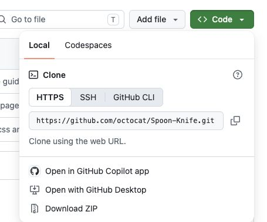
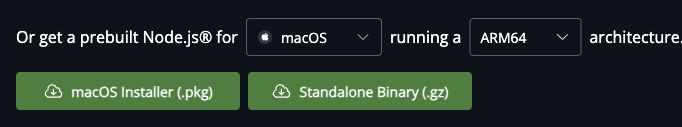

# 第一次在自己的電腦開啟產品

先跟同事拿到**產品的 GitHub 網址**，確認你的公司帳號能開分支、送出修改。第一次設定好，下次在 AI 工具裡開同一個產品資料夾就能繼續。

| 你手上已經有什麼？ | 從哪裡開始 |
| --- | --- |
| 一台電腦和同事給的 GitHub 網址 | [先檢查 Git](#安裝-git)，再下載產品 |
| 產品資料夾已經在電腦裡 | 用 AI 工具開啟資料夾，[確認 Node.js 版本](#安裝產品需要的-nodejs) |
| 已經能在這台電腦開產品的 Storybook | [安裝工作用的 Skill](#把這本手冊的-skill-交給-ai) |

## 安裝 Git

Git 會把團隊的程式碼下載到你的電腦，也會記住你改了哪些地方。先查電腦有沒有裝過。在 Mac 上按 `⌘ + 空白鍵` 搜尋「終端機」，在 Windows 上從開始功能表搜尋「PowerShell」。打開後貼上這行，按 Enter。

```sh
git --version
```

看到 `git version` 和一串數字，就可以往下走。如果找不到指令，依你的電腦選一種做法。

**Mac** 執行 `git --version` 後，如果跳出安裝「命令列開發者工具」的視窗，點「安裝」。Apple 提供的這套工具裡就有 Git。若沒有跳出視窗，可用這行指令叫出來。[Git 的 macOS 安裝說明](https://git-scm.com/install/mac)

```sh
xcode-select --install
```

**Windows** 打開下載頁，在 **Standalone Installer** 選符合電腦的 **x64 Setup** 或 **ARM64 Setup**。不確定時，去「設定 → 系統 → 關於」看「系統類型」。打開下載好的安裝檔，依畫面完成安裝。[Git for Windows 下載頁](https://git-scm.com/install/windows)

裝好後，關掉終端機或 PowerShell，重新開啟，再跑一次 `git --version`。

## 到 GitHub 複製產品網址

團隊在 GitHub 上存放產品的地方叫 **repository**，通常簡稱 **repo**。這本手冊也有自己的 repo。要改產品，請開同事給你的那一個。

1. 用公司帳號登入 GitHub，打開產品 repo 的首頁。
2. 在檔案清單右上方點綠色的 **Code**。
3. 在 **Local** 裡選 **HTTPS**，點網址右側兩個方框重疊的複製圖示。剪貼簿裡現在就是 Git 下載專案用的網址。



圖中是 GitHub 的公開示範專案。你複製的網址會顯示公司的組織和產品名稱。如果同事給的頁面顯示 404，先確認登入的是公司帳號，再請同事確認你有存取權。[GitHub 官方複製教學](https://docs.github.com/en/repositories/creating-and-managing-repositories/cloning-a-repository)

## 把產品放到電腦上

挑一個以後找得到的位置，例如在「文件」裡建立「工作專案」資料夾。用團隊平常的 AI 開發工具開啟這個資料夾，再貼上這段話，記得換掉最後一行。

```text
幫我把這個產品下載到目前的資料夾。下載好後，告訴我接下來要開哪個產品資料夾。
GitHub 網址：貼上剛剛複製的 HTTPS 網址
```

這個動作叫 **clone**。如果登入視窗跳出來，用有權限的公司帳號完成登入。下載好後，在 AI 工具裡打開剛才新增的產品資料夾。若電腦裡本來就有這個產品，直接開原本的資料夾即可。

## 安裝產品需要的 Node.js

Storybook 需要用 Node.js 在你的電腦上跑。版本先讓 AI 看，這樣比較不會裝好才發現專案要用另一版。

```text
幫我看看這個產品規定用哪一版 Node.js，我的電腦有沒有裝好？
如果需要安裝，請告訴我要選哪一版。
```

AI 如果說已經可以用，就往下一節走。若產品有自己的安裝方式，照 AI 查到的專案說明操作。從官網下載時，在頁面上方選剛確認的版本。專案沒指定的話，選標示 **LTS** 的長期支援版。[Node.js 官方下載頁](https://nodejs.org/en/download)

往下捲到 **Or get a prebuilt Node.js®**，選你的作業系統與處理器。Mac 可以在「關於這台 Mac」看是 Apple 晶片（**ARM64**）還是 Intel（**x64**）。選好後，Mac 點 **macOS Installer (.pkg)**，Windows 點 **Windows Installer (.msi)**。打開下載好的檔案，依畫面完成安裝。



重新開啟終端機或 PowerShell，貼上這行。看到的版本應該和 AI 剛才查到的相符。如果 AI 工具仍說找不到 Node.js，把工具關掉重開，再請它檢查一次。

```sh
node --version
```

## 把這本手冊的 Skill 交給 AI

**Skill** 是 AI 工作時會參照的說明書。這份 Skill 有兩個檔案，一個寫工作流程，一個讓 Codex 只在你點名時啟用它。從 GitHub 下載這兩個檔案，附到**產品資料夾**的 AI 對話裡。如果手冊已經在電腦上，也可以直接提供整個 `design-with-storybook` 資料夾的路徑。[工作流程 SKILL.md](../.agents/skills/design-with-storybook/SKILL.md) · [啟用設定 openai.yaml](../.agents/skills/design-with-storybook/agents/openai.yaml)

```text
請幫我安裝或更新 design-with-storybook，這次只做安裝。
請把 SKILL.md 和 agents/openai.yaml 一起放到產品本機的 .agents/skills/design-with-storybook/。
如果你的工具有自己的 Skill 目錄或手動啟用設定，請用對應的方式處理。
我希望在提示詞裡點名它才啟動。若工具無法關閉自動啟用，就放在不會被自動載入的位置，告訴我要怎麼手動使用。
請把安裝檔留在本機。裝好後告訴我需不需要重開對話。
```

裝好後，挑一個你熟悉的畫面，在第一則提示詞裡選用 `$design-with-storybook`。如果工具沒有 Skill 選單，就附上 `SKILL.md`，在提示詞裡寫明要用這份 Skill。同一個任務接著用平常的話回覆就好。換任務或另開對話時，再點名一次。[Agent Skills 格式說明](https://agentskills.io/specification)

---

[回到手冊目錄](../README.md#手冊目錄) · [下一章：一起改一次邀請表單 →](first-change.md)
